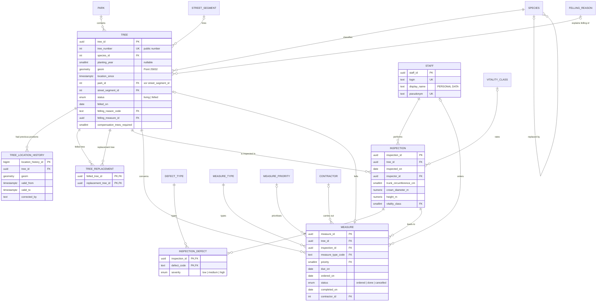

# Urban Tree Cadastre: logical data model

Draft v0.1, 2026-11-23. Physical DDL: `sql/01_schema.sql`. Assumption IDs (A-xx) refer to `ASSUMPTIONS.md`.

## Entity-relationship diagram

The `audit_log` table (generic, filled by trigger for all business tables) is not shown.

## Entities

| Entity | Purpose | Key | Notes |
|---|---|---|---|
| `tree` | One row per tree ever recorded, living or felled (UC1, UC4) | `tree_id` (UUID, created on the tablet) and `tree_number` (public) | Location is a PostGIS point in EPSG:25832. Exactly one of park or street segment (A-09). Felling data is present only when `status = 'felled'`. |
| `tree_location_history` | Previous positions after GPS corrections | identity | Written by trigger whenever `tree.geom` changes. Append-only. Stores who corrected the position, when, and an optional reason. |
| `tree_replacement` | Compensation planting, linking a felled tree to its new tree(s) | (felled, replacement) | n:m (A-16). Paired with `tree.compensation_trees_required` and the view `v_compensation_status`. |
| `inspection` | Annual inspection (UC2) | `inspection_id` (UUID) | Cannot be deleted. Every change is audited. Vitality is mandatory, measurements are optional (A-26). |
| `inspection_defect` | Defects found in an inspection | (inspection, defect_code) | Severity is low, medium or high (enum). |
| `measure` | Work ordered from an inspection (UC3) | `measure_id` (UUID) | Status goes ordered → done or cancelled. A composite FK `(inspection_id, tree_id)` ensures the measure's tree is the inspected tree. |
| `species` | City species list, about 900 entries, extended by arborists | identity | Deactivated, never deleted. `genus` is a generated column. |
| `defect_type`, `measure_type`, `measure_priority`, `vitality_class`, `felling_reason` | Code lists | natural code | Seed values in `sql/04_codelists_seed.sql` are placeholders. |
| `staff` | Inspectors and arborists | UUID | Personal data. The `pseudonym` column is used in the exchange file. |
| `contractor` | Companies or the in-house crew carrying out measures | identity | |
| `park`, `street_segment` | Spatial reference units from the city GIS | identity, plus an optional business code | |
| `audit_log` | Who changed what and when, with old and new row as JSONB | identity | Append-only. Readable only by the auditor role. |

## Design decisions

1. **Nothing is ever deleted.** Trees, inspections, measures, staff, contractors, species, the location history and the audit log are protected by `BEFORE DELETE/TRUNCATE` triggers, and the app role has no DELETE privilege. A tree is ended with `status = felled`, a measure with `cancelled`, and a code entry with `is_active = false`.
2. **Audit through a generic trigger.** `cadastre.trg_audit()` writes I/U/D rows with changed columns, old and new values, the timestamp, the transaction id and the actor. The actor comes from `SET LOCAL app.actor`, which the app sets on every transaction. The application can therefore use a single connection pool account and still record the real user.
3. **Offline-first keys.** UUIDs are generated on the tablet, and a `row_version` column is used for optimistic locking during the evening sync (A-07, A-28).
4. **Legacy records are flagged, not invented.** `is_legacy_import` relaxes only the checks that legacy data cannot satisfy (A-20). The app can show these records as "incomplete, needs review".
5. **Map performance.** GiST index on `tree.geom`, plus a partial GiST index on living trees. `inspection(tree_id, inspected_on DESC, created_at DESC)` serves the latest-vitality lookup. The map view is `cadastre.v_tree_map`, filtered with `geom && ST_MakeEnvelope(...)` (A-27).
6. **Separate schemas for publication.** `opendata` contains only the materialized view `opendata.tree`, with no personal data and its own role. `exchange` contains the function that builds the agency file.
7. **Exchange file.** It is generated in the database by `exchange.build_exchange_file()`, so it always matches the schema. It is not GeoJSON, because the coordinates stay in EPSG:25832 (A-29).

## Requirement traceability

| Requirement | Where it is covered |
|---|---|
| UC1: register tree (point in 25832, species from list, planting year, park or segment) | `tree`, `species`, `park`, `street_segment`. `geometry(Point,25832)`. `tree_location_unit_ck`. Trigger `tree_active_species`. |
| UC1: species list extended by arborists | `species` and the `cadastre_codelist` role |
| UC2: inspection fields and vitality 1–5 | `inspection`, `vitality_class` (A-10) |
| UC2: any number of defects from a fixed list, with severity | `inspection_defect`, `defect_type`, enum `defect_severity` |
| UC2: never delete; auditors see who changed what | `trg_forbid_delete`, privileges, `audit_log` and `trg_audit` |
| UC3: measures with due date, priority, completion date and contractor | `measure`, `measure_type`, `measure_priority`, `contractor`, `measure_done_ck` |
| UC4: felled trees kept, with date and reason | `tree.status`, `felled_on`, `felling_reason_code`, `tree_felled_has_felling_data_ck` |
| UC4: compensation planting, one or more new trees | `tree_replacement`, `compensation_trees_required`, `v_compensation_status` |
| UC5: nightly open data of living trees | `opendata.tree` (materialized view) and the `opendata_reader` role |
| UC5: monthly exchange file for the agency | `exchange.build_exchange_file()` and `json/tree-exchange.schema.json` |
| 180k trees, 200k inspections/yr for 30 years, 25k measures/yr | Indexes, BRIN on `audit_log.changed_at`, no partitioning needed (A-27) |
| Bounding box of about 5,000 trees in under 1 s | GiST indexes and `v_tree_map` (not benchmarked yet) |
| Offline tablets syncing in the evening | Client UUIDs, `row_version`, `updated_at` indexes (A-28) |
| Inspector names are personal data | `staff` only. Pseudonym in the exchange file. Not in open data (A-17). |
| Location corrections with previous location and time | `tree_location_history`, `location_since`, trigger `tree_location_history` |
