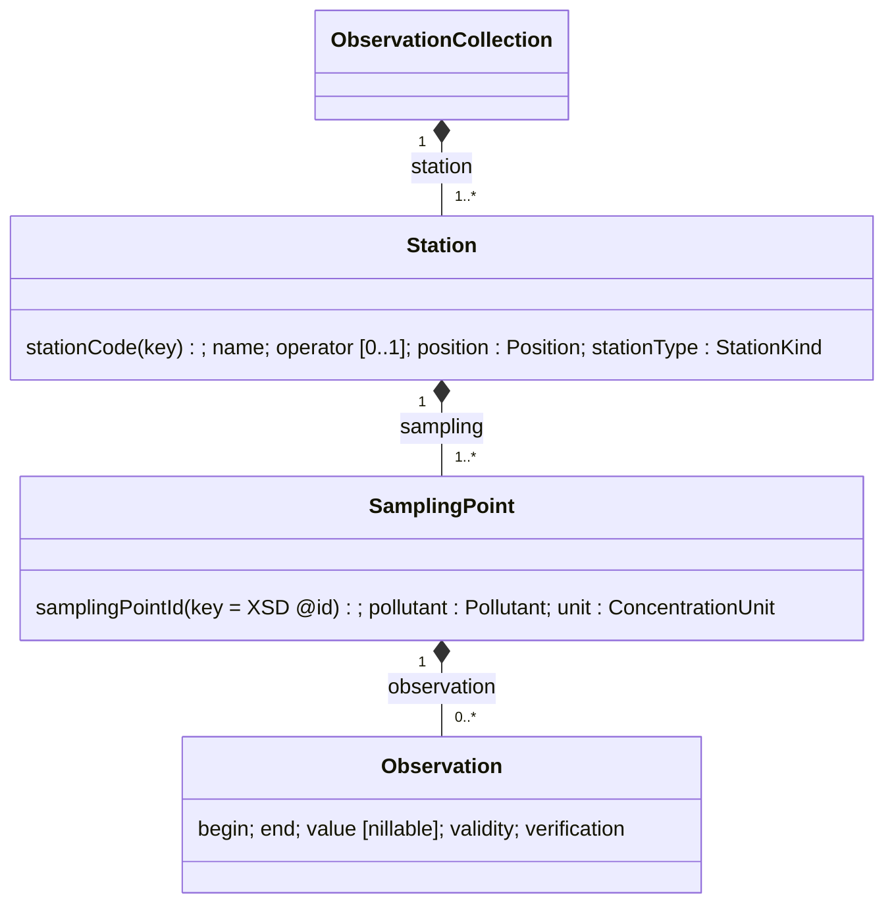

I turned your XSD 2.1 into a canonical model in `datamodel/` and generated a JSON Schema and an XSD from it. The XSD reproduces the 2.1 wire format. Everything is draft 0.1.0 and not released. Where the XSD was silent I made an assumption and logged it for your review.

## The model

| Element | What it is | Identity |
|---|---|---|
| ObservationCollection | One partner delivery. It only wraps the data for exchange | none |
| Station | A monitoring site (~400) | `stationCode` |
| SamplingPoint | One pollutant measured at one station, in one unit (~2,400) | `samplingPointId`, which is the XSD `@id` |
| Observation | One value for the interval [begin, end), usually one hour (~57,600/day, ~21 M/year) | (sampling point, begin) |
| Position | A value type with lat, lon and optional altitude | n/a |
| Code lists | StationKind is closed. Pollutant and ConcentrationUnit are open. ObservationValidity and VerificationStatus are closed, using the EEA codes (assumed) | n/a |

All element and type names match the 2.1 names, so partners see no changes.

## Problems in the XSD, most important first

1. **Identifiers are only valid inside one file.** `station/@id` and `sampling/@id` are `xs:ID`, which means:
   - They only have to be unique within a single XML document.
   - They must be XML names, so they cannot start with a digit.
   - Nothing says they stay the same from one delivery to the next.

   Sampling points have no other identifier, so if these IDs aren't stable you can't build REST URLs or link one delivery's time series to the next (Q-001).
2. **`validity` and `verification` are bare `xs:int`.** The XSD gives no list of values and no meaning for them. I assumed the EEA code lists: validity −99/−1/1/2/3, verification 1/2/3 (Q-005).
3. **Times can lack a time zone.** `xs:dateTime` accepts local times without an offset, which makes hourly data ambiguous around DST changes. The XSD also doesn't say whether `end` is included in the interval (Q-006).
4. **Deliveries carry no metadata.** There is no sender, creation time, reporting period or delivery ID, and no "this replaces an earlier delivery" flag. As a result corrections and resubmissions can't be recognised reliably (Q-007).
5. **`pollutant` and `unit` are free text.** The pollutant is only documented as "EEA vocabulary" with three examples. Units have no list at all, and spellings like µg/m3, ug.m-3 and ug/m3 could all appear (Q-003, Q-004).
6. **Nothing prevents duplicate observations.** The XSD has no uniqueness rule for (sampling point, begin) and no check that `end > begin` or that intervals don't overlap.
7. **`value` is a nillable `xs:double` with no rule linking it to `validity`.** It's unclear what a nil value with validity 1 would mean. `xs:double` also allows NaN and INF, which JSON can't represent.
8. **`altitude` can be both optional and nillable.** That gives two ways to say "unknown". The coordinate system, the altitude unit and the lat/lon ranges are not specified (A-005, A-006).
9. **The version is part of the namespace (`…/2.1`).** If 2.2 gets a new namespace, every partner and parser has to change, even for an additive change (Q-010).
10. **Smaller points:**
    - `stationType` has no area classification (urban/suburban/rural).
    - `operator` is free text.
    - There are no length limits.
    - Every delivery repeats all station metadata.

## Decisions taken on your behalf

All of these are in `decisions.md` and are provisional until you review them.

- **Names (D-002):** I kept the XSD names, so the JSON has singular array names: `"station": [...]`, `"sampling": [...]`, `"observation": [...]`. If you want plural names in the API, decide that before you publish it (Q-011).
- **Station identity (D-005):** a station is identified by `stationCode`. Its `@id` is treated as a label that only matters inside one file.
- **`samplingPointId` (D-005):** I assumed the sampling-point `@id` stays the same across deliveries and used it as `samplingPointId`.
- **XSD compatibility step (D-005):** the generator can't produce `xs:ID` attributes or integer enumerations. A small script, `datamodel/tools/xsd_compat_2_1.py`, applies four fixed changes to produce the 2.1-compatible XSD. The plain generated XSD is **not** compatible with 2.1.
- **Stricter than 2.1 (D-007, D-004):**
  - The validity and verification codes are closed lists.
  - lat must be between −90 and 90, and lon between −180 and 180.

  A 2.1 file with a different validity code would now be rejected.
- **JSON Schema root (D-008):** the root is the full delivery, intended for a bulk upload endpoint. A full day of data is roughly 8–10 MB of JSON, so the read endpoints should page observations by time window rather than embed them.
- **History (D-010):** only an audit trail. There is no versioned history in the payloads, which keeps the 2.1 structure unchanged.

## Checks

- A sample delivery (`examples/delivery.xml`) is valid against both your original `observations.xsd` and the generated 2.1-compatible XSD.
- The same delivery as JSON (`examples/delivery.json`) is valid against the JSON Schema. The schema itself passes the 2020-12 meta-schema check.
- An invalid validity code and an unknown property are both rejected.
- **Not checked:**
  - The `date-time` format, because no validator for it was installed.
  - The cross-field rules C-001 to C-007. They appear only as documentation in the schemas, so they need to be enforced in the API or ingest code.

## Files

In `datamodel/`:
- `model.yaml`: the canonical model.
- `sources.md`, `decisions.md`, `open-questions.md`, `glossary.md`, `CHANGELOG.md`.
- `tools/xsd_compat_2_1.py`: the compatibility step.

In `datamodel/exports/0.1.0/`:
- `airquality.schema.json`: the JSON Schema 2020-12.
- `airquality-2.1-compat.xsd`: the partner wire format.
- `airquality.xsd`: the plain generated XSD.
- `model.mmd`: the diagram.
- `examples/`: the sample delivery in XML and JSON.
- `README.md`: how each file is regenerated.

## For your review

Four questions block the next steps:
- **Q-001:** are the sampling-point IDs stable and unique?
- **Q-005:** what do the validity and verification codes mean?
- **Q-006:** what time zone do the timestamps use?
- **Q-007:** how are corrections and resubmissions recognised?

Then decide on API naming (Q-011) and confirm the six pollutants (A-002: NO2, PM10, PM2.5, O3, SO2, CO). After that I can:
1. Write an OpenAPI 3.1 spec with per-resource schemas and paged observations.
2. Optionally write PostgreSQL DDL. At ~21 M observations a year it would partition observations by month.
3. Release the model as 1.0.0.
