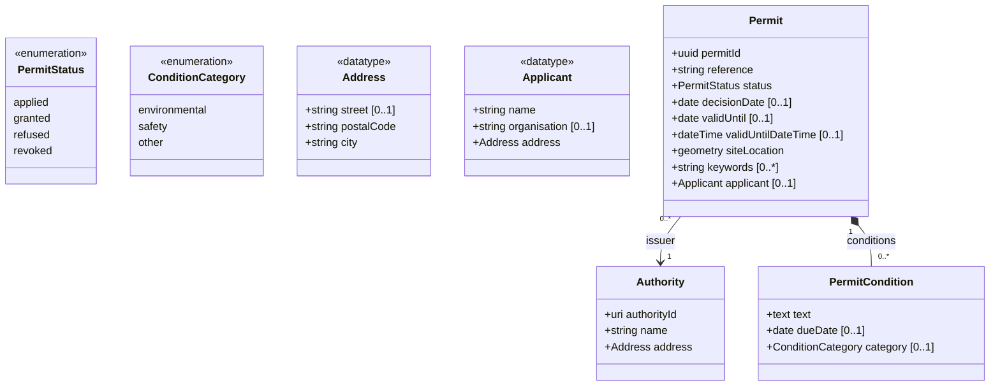

# Permit Registry Model 1.0.0

Permits issued by authorities, with their conditions.

## Overview

| | |
|---|---|
| Version | 1.0.0 |
| Status | draft |
| Purposes | persistence, exchange |
| Languages | en |
| Namespace | https://example.org/models/permit-registry |

## Review status

**Not yet confirmed (proposed):** none

**Missing translations:** none

**Open questions and assumptions:**

- Q-001 Projection or major version for CR-7? (BLOCKS RELEASE) (2026-11-23)
- Q-002 Time zone and producers of `validUntilDateTime` (2026-11-23)
- Q-003 Does the applicant need its own identity? (2026-11-23)
- Q-004 Personal data: legal basis, retention and partner access for applicant data (2026-11-23)
- Q-005 Must new conditions have a category? (2026-11-23)
- Q-006 Backlog for the next major version (2026-11-23)
- A-001: `validUntilDateTime` is exchanged with an explicit UTC offset. The local date for `validUntil` (C-004) is taken in the issuing authority's time zone.
- A-002: for permits that only have `validUntil`, validity ends at the end of that day (local time) when deriving "expired".
- A-003: partners only need "expired" as something they can compute, not as a status value they receive.
- A-004: within an applicant, `name` and `address` are mandatory and `organisation` is optional ("name + optional organisation + address", CR-7). The address reuses `Address`, so postalCode and city are mandatory and street is optional.

## Diagram

## Object types

### Authority

Public body competent to issue permits.

- Identifier: `authorityId` (uri)
- History: audit
- Volume: 500 (+stable)
- Source: S1

| Attribute | Label | Type | Mult. | Definition | Notes |
|---|---|---|---|---|---|
| `authorityId` |  | uri | 1 | Persistent URI of the authority. | unique |
| `name` |  | string | 1 |  | maxLength=200 |
| `address` |  | Address | 1 |  |  |

### Permit

Official authorisation granted to an applicant for an activity at a site.

- Identifier: `permitId` (uuid)
- History: versioned
- Volume: 2000000 (+200000/year)
- Source: S1, S2

| Attribute | Label | Type | Mult. | Definition | Notes |
|---|---|---|---|---|---|
| `permitId` |  | uuid | 1 | Stable identifier of the permit. | unique |
| `reference` | File number | string | 1 | Human-readable file number used by the authority (called "file number" by the clerks). | maxLength=40, unique |
| `status` |  | PermitStatus | 1 |  |  |
| `decisionDate` |  | date | 0..1 |  |  |
| `validUntil` |  | date | 0..1 | Last day the permit is valid. Kept for existing consumers; must equal the local date of validUntilDateTime when both are present. | voidable, **deprecated** |
| `validUntilDateTime` |  | dateTime | 0..1 | Instant at which the permit ceases to be valid, with time zone offset. | voidable, since 1.1.0, Source: S2 |
| `siteLocation` |  | geometry | 1 |  | geometryType=Polygon, crs=EPSG:4326 |
| `keywords` |  | string | 0..* |  | maxLength=50, **deprecated**, Source: S1, S2 |
| `applicant` |  | Applicant | 0..1 | Applicant of the permit. Optional in the schema because it is unknown for many permits issued before 1.1.0; mandatory for new permits (C-002). | since 1.1.0, Source: S2 |

**Associations**

| Role | Target | Mult. | Kind | Definition |
|---|---|---|---|---|
| `issuer` | Authority | 1 | reference | The authority that issued the permit. |
| `conditions` | PermitCondition | 0..* | composition |  |

### PermitCondition

Obligation attached to a permit.

| Attribute | Label | Type | Mult. | Definition | Notes |
|---|---|---|---|---|---|
| `text` |  | text | 1 |  |  |
| `dueDate` |  | date | 0..1 |  |  |
| `category` |  | ConditionCategory | 0..1 | Kind of obligation. Optional because existing conditions are not categorised. | since 1.1.0, Source: S2 |

## Value types

### Address

Postal address.

| Attribute | Label | Type | Mult. | Definition | Notes |
|---|---|---|---|---|---|
| `street` |  | string | 0..1 |  | maxLength=200 |
| `postalCode` |  | string | 1 |  | maxLength=10 |
| `city` |  | string | 1 |  | maxLength=100 |

### Applicant

Person or organisation that applied for a permit, as recorded on the permit.

- Source: S2

| Attribute | Label | Type | Mult. | Definition | Notes |
|---|---|---|---|---|---|
| `name` |  | string | 1 | Name of the applicant (natural person or contact person). | maxLength=200 |
| `organisation` |  | string | 0..1 | Organisation the applicant acts for, if any. | maxLength=200 |
| `address` |  | Address | 1 |  |  |

## Code lists

### PermitStatus

Lifecycle status of a permit.

- Source: S1

*closed*

| Code | Label | Definition |
|---|---|---|
| `applied` |  | Application received |
| `granted` |  |  |
| `refused` |  |  |
| `revoked` |  |  |

### ConditionCategory

Kind of obligation a permit condition imposes.

- Source: S2

*extensible*

| Code | Label | Definition |
|---|---|---|
| `environmental` | Environmental | Obligation protecting the environment. |
| `safety` | Safety | Obligation concerning the safety of people or property. |
| `other` | Other | Any other obligation. |

## Rules

| ID | Applies to | Rule | Enforcement |
|---|---|---|---|
| C-001 | Permit | validUntil must not be before decisionDate. | enforced, all |
| C-002 | Permit | Every permit created from version 1.1.0 on must have an applicant. | enforced, new |
| C-003 | Permit | validUntilDateTime must not be before decisionDate. | enforced, new |
| C-004 | Permit | For permits created from 1.1.0 on, if validUntilDateTime is present, validUntil must also be filled with its local calendar date (keeps old consumers informed). | enforced, new |
| C-005 | Permit | Derivation rule (not a stored value): a permit is "expired" when status = granted and validUntilDateTime (or, if absent, the end of the day validUntil) lies in the past. | documented, all |

---
*Generated by dmtool docs from PermitRegistry 1.0.0 (en).*
