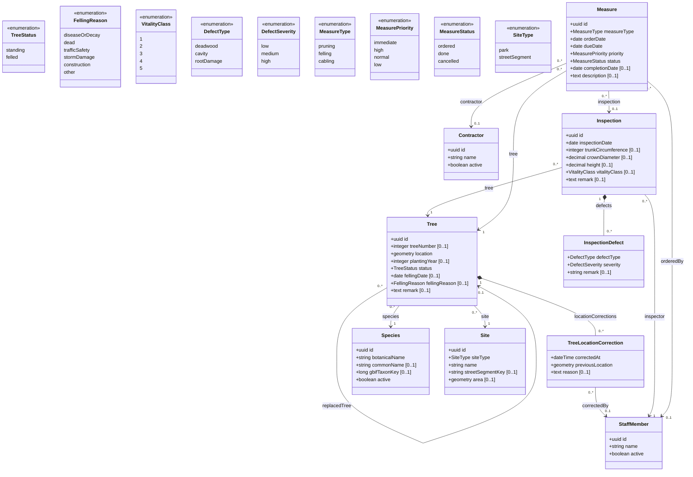

# Urban Tree Cadastre 0.1.0

Street and park trees of the city with their locations, species, inspections, defects, ordered maintenance measures, fellings and compensation plantings. Used as the operational database of the parks department and as the basis for the monthly exchange file to the regional environmental agency and the nightly open data export.

## Overview

| | |
|---|---|
| Version | 0.1.0 |
| Status | draft |
| Purposes | persistence, exchange |
| Languages | en |
| Namespace | https://example.org/models/urban-tree-cadastre |

## Review status

**Not yet confirmed (proposed):** elements still 'proposed': ['TreeStatus', 'FellingReason', 'VitalityClass', 'DefectType', 'MeasureType', 'MeasurePriority', 'MeasureStatus', 'Tree.treeNumber', 'Tree.remark', 'Species.commonName', 'Species.gbifTaxonKey', 'Species.active', 'Site.streetSegmentKey', 'Site.area', 'Inspection.remark', 'InspectionDefect.remark', 'Measure.orderDate', 'Measure.description', 'MeasureTree', 'MeasureOrderedBy']

**Missing translations:** none

**Open questions and assumptions:**

- **Q-001 (blocking before release)** Vitality scale: S1/S2 use classes 1–5 "according to Roloff", but Roloff's published key has 4 classes (0–3). Does the city use its own 5-level scale (and is 1 = best?), or should we switch to Roloff 0–3 and map legacy values? — owner: arborist team
- **Q-002** Is `baum_nr` physically on the trees (tags), and must new trees get a number immediately (offline), or is server assignment at sync acceptable?
- **Q-003** Please provide the full defect list and measure-type list (and the distinct legacy values of `massnahme.art` and `kontrolle.maengel`) so the code lists can be completed.
- **Q-004** Is there a street register with segment keys (which one)? Do parks have official boundaries we can reference?
- **Q-005** Can one new tree compensate for several felled trees? Is a required number of compensation trees per felled tree (tree protection bylaw) to be tracked?
- **Q-006** Exchange file: full snapshot every month or only changes since the last file? Include felled trees and logically deleted records?
- **Q-007** Retention for staff data and audit trails; may pseudonymous inspector UUIDs be passed to the agency?
- **Q-008** Which CRS/format does the agency expect (EPSG:25832 vs. WGS 84 GeoJSON), and does it validate strictly against our schema?
- **Q-009** Offline sync conflicts: what wins if the office and a tablet change the same tree on the same day?
- **Q-010** Official namespace URI for the model / schema `$id` (placeholder `https://example.org/models/urban-tree-cadastre`).
- **Q-011** "Latest vitality" for open data: the latest inspection that has a vitality class, or the latest inspection at all?
- A-001 Documentation in English only; German can be added (confirmed: no)
- A-002 Tree location is a point (trunk position) in EPSG:25832 (confirmed: no)
- A-003 Every tree belongs to exactly one site (park or street segment); legacy rows with neither or both need cleaning (confirmed: no)
- A-004 Trunk circumference, crown diameter and height are optional per inspection; vitality is mandatory for new inspections (C-005) (confirmed: no)
- A-005 Vitality 1 = best, 5 = worst (confirmed: no — see Q-001)
- A-006 Trunk circumference measured at 1 m height (confirmed: no)
- A-007 Felling reasons: disease/decay, dead, traffic safety, storm damage, construction, other (confirmed: no)
- A-008 Measure priority: immediate / high / normal / low (confirmed: no)
- A-009 Measures can be cancelled (status `cancelled`) instead of deleted (confirmed: no)
- A-010 Measures kept 30 years like inspections; trees kept indefinitely (confirmed: no)
- A-011 Exchange file contains staff UUIDs but no names; open data contains no staff reference (confirmed: no)
- A-012 The regional agency validates strictly → closed JSON Schema (confirmed: no)
- A-013 Tree status only standing/felled; a dead tree still standing is `standing` with low vitality; storm-thrown trees are `felled` with reason `stormDamage` (confirmed: no)
- A-014 "Who changed what" via generic audit history tables for all entity classes; no business-level versioning (confirmed: no)
- A-015 Legacy felled trees have no felling date/reason, so C-001 applies only to new data (scope new) (confirmed: no)
- A-016 Offline sync is an application concern; the model only provides client-generated UUIDs and audit timestamps (confirmed: no — see Q-009)

## Diagram

## Object types

### Tree

An individual street or park tree managed by the city. Felled trees remain in the cadastre with status 'felled'.

- Identifier: `id` (uuid)
- History: audit
- Volume: 180000 (+3000/year)
- Source: S1, S2

| Attribute | Label | Type | Mult. | Definition | Notes |
|---|---|---|---|---|---|
| `id` |  | uuid | 1 | Stable identifier, generated on the tablet when the tree is registered (works offline). | unique |
| `treeNumber` |  | integer | 0..1 | Human-readable tree number (legacy baum_nr, tag number on the tree). Assigned by the server; empty until the first sync for trees registered offline. | min=1, unique, *proposed*, Source: S2 |
| `location` |  | geometry | 1 | Current position of the trunk. Previous positions are kept in locationCorrections. | geometryType=Point, crs=EPSG:25832, Source: S1 |
| `plantingYear` |  | integer | 0..1 | Year of planting, if known. | min=1600, max=2100, Source: S1, S2 |
| `status` |  | TreeStatus | 1 | Lifecycle status. | Source: S1, S2 |
| `fellingDate` |  | date | 0..1 | Date the tree was felled (only for status felled). | Source: S1 |
| `fellingReason` |  | FellingReason | 0..1 | Reason for felling (only for status felled). | Source: S1 |
| `remark` |  | text | 0..1 | Free-text remark. | maxLength=2000, *proposed* |

**Associations**

| Role | Target | Mult. | Kind | Definition |
|---|---|---|---|---|
| `species` | Species | 1 | reference | Species of the tree. |
| `site` | Site | 1 | reference | Park or street segment the tree belongs to. |
| `replacedTree` | Tree | 0..1 | reference | Compensation planting - the new tree replaces a felled tree. A felled tree may be replaced by several new trees. |
| `locationCorrections` | TreeLocationCorrection | 0..* | composition | Corrections of the tree's position, oldest first. |

### TreeLocationCorrection

Record of a correction of a tree's position (e.g. GPS error), keeping the previous position and when it was corrected.

- History: none
- Source: S1

| Attribute | Label | Type | Mult. | Definition | Notes |
|---|---|---|---|---|---|
| `correctedAt` |  | dateTime | 1 | When the correction was made. |  |
| `previousLocation` |  | geometry | 1 | Position before the correction. | geometryType=Point, crs=EPSG:25832 |
| `reason` |  | text | 0..1 | Why the position was corrected. | maxLength=500 |

**Associations**

| Role | Target | Mult. | Kind | Definition |
|---|---|---|---|---|
| `correctedBy` | StaffMember | 0..1 | reference | Staff member who corrected the position. |

### Species

Entry of the city's species list (botanical taxon), maintained by the arborist team.

- Identifier: `id` (uuid)
- History: audit
- Volume: 900 (+a few entries per year)
- Source: S1

| Attribute | Label | Type | Mult. | Definition | Notes |
|---|---|---|---|---|---|
| `id` |  | uuid | 1 | Stable identifier of the species list entry. | unique |
| `botanicalName` |  | string | 1 | Scientific name (genus, species, optionally cultivar), e.g. 'Tilia cordata' or "Acer platanoides 'Columnare'". | maxLength=120, unique, Source: S1, S2 |
| `commonName` |  | string | 0..1 | Vernacular name used by the department. | maxLength=120, *proposed* |
| `gbifTaxonKey` |  | long | 0..1 | Key of the matching taxon in the GBIF Backbone Taxonomy (https://www.gbif.org/species/{key}), for unambiguous exchange. | *proposed*, Source: S3 |
| `active` |  | boolean | 1 | Whether the entry may be chosen for new trees. | *proposed* |

### Site

Park or street segment a tree belongs to.

- Identifier: `id` (uuid)
- History: audit
- Volume: 5000 (+stable)
- Source: S1, S2

| Attribute | Label | Type | Mult. | Definition | Notes |
|---|---|---|---|---|---|
| `id` |  | uuid | 1 | Stable identifier of the site. | unique |
| `siteType` |  | SiteType | 1 | Park or street segment. |  |
| `name` |  | string | 1 | Name of the park or street. | maxLength=100, Source: S2 |
| `streetSegmentKey` |  | string | 0..1 | Key of the segment in the city's street register (street segments only). | maxLength=40, *proposed* |
| `area` |  | geometry | 0..1 | Outline (park) or axis (street segment) of the site. | geometryType=Geometry, crs=EPSG:25832, *proposed* |

### StaffMember

Employee of the parks department acting as inspector or arborist. Personal data.

- Identifier: `id` (uuid)
- History: audit
- Volume: 50 (+stable)
- Source: S1

| Attribute | Label | Type | Mult. | Definition | Notes |
|---|---|---|---|---|---|
| `id` |  | uuid | 1 | Pseudonymous identifier; may appear in the agency exchange file, never with the name. | unique |
| `name` |  | string | 1 | Full name. Personal data - must not appear in open data or the exchange file. | maxLength=100, Source: S1, S2 |
| `active` |  | boolean | 1 | Whether the person currently works for the department. |  |

### Contractor

Company that carries out measures.

- Identifier: `id` (uuid)
- History: audit
- Volume: 100 (+stable)
- Source: S1, S2

| Attribute | Label | Type | Mult. | Definition | Notes |
|---|---|---|---|---|---|
| `id` |  | uuid | 1 | Stable identifier of the contractor. | unique |
| `name` |  | string | 1 | Company name. | maxLength=100, Source: S2 |
| `active` |  | boolean | 1 | Whether the contractor can be assigned to new measures. |  |

### Inspection

Visual inspection of one tree on one date by an inspector. Never deleted.

- Identifier: `id` (uuid)
- History: audit
- Source: S1, S2

| Attribute | Label | Type | Mult. | Definition | Notes |
|---|---|---|---|---|---|
| `id` |  | uuid | 1 | Stable identifier, generated on the tablet. | unique |
| `inspectionDate` |  | date | 1 | Date of the inspection. | Source: S1, S2 |
| `trunkCircumference` |  | integer | 0..1 | Trunk circumference measured at 1 m above ground (A-006). | min=1, max=2000, unit=cm, Source: S1, S2 |
| `crownDiameter` |  | decimal | 0..1 | Crown diameter. | precision=4, scale=1, min=0, max=99.9, unit=m, Source: S1 |
| `height` |  | decimal | 0..1 | Tree height. | precision=4, scale=1, min=0, max=99.9, unit=m, Source: S1, S2 |
| `vitalityClass` |  | VitalityClass | 0..1 | Vitality class (mandatory for new inspections, see C-005; optional for migrated legacy data). | Source: S1, S2 |
| `remark` |  | text | 0..1 | Free-text remark of the inspector. | maxLength=2000, *proposed* |

**Associations**

| Role | Target | Mult. | Kind | Definition |
|---|---|---|---|---|
| `tree` | Tree | 1 | reference | The tree that was inspected. |
| `inspector` | StaffMember | 1 | reference | The inspector who carried out the inspection. |
| `defects` | InspectionDefect | 0..* | composition | Defects found at the inspection. |

### InspectionDefect

A defect found at an inspection, with its severity.

- History: none
- Source: S1, S2

| Attribute | Label | Type | Mult. | Definition | Notes |
|---|---|---|---|---|---|
| `defectType` |  | DefectType | 1 | Kind of defect. |  |
| `severity` |  | DefectSeverity | 1 | Severity of the defect. |  |
| `remark` |  | string | 0..1 | Short note, e.g. position on the tree. | maxLength=200, *proposed* |

### Measure

Maintenance measure ordered for a tree, normally from an inspection, and later completed by a contractor.

- Identifier: `id` (uuid)
- History: audit
- Source: S1, S2

| Attribute | Label | Type | Mult. | Definition | Notes |
|---|---|---|---|---|---|
| `id` |  | uuid | 1 | Stable identifier. | unique |
| `measureType` |  | MeasureType | 1 | Kind of measure. | Source: S1, S2 |
| `orderDate` |  | date | 1 | Date the measure was ordered. | *proposed* |
| `dueDate` |  | date | 1 | Date by which the measure must be done. | Source: S1, S2 |
| `priority` |  | MeasurePriority | 1 | Urgency. | Source: S1 |
| `status` |  | MeasureStatus | 1 | Processing status. |  |
| `completionDate` |  | date | 0..1 | Date the measure was completed (status done). | Source: S1, S2 |
| `description` |  | text | 0..1 | Details of the work to be done. | maxLength=2000, *proposed* |

**Associations**

| Role | Target | Mult. | Kind | Definition |
|---|---|---|---|---|
| `tree` | Tree | 1 | reference | The tree the measure is for. |
| `inspection` | Inspection | 0..1 | reference | The inspection from which the measure was ordered. |
| `orderedBy` | StaffMember | 0..1 | reference | Arborist who ordered the measure. |
| `contractor` | Contractor | 0..1 | reference | Contractor that carried out the measure. |

## Code lists

### TreeStatus

Lifecycle status of a tree in the cadastre.

- Source: S1, S2
- *proposed*

*closed*

| Code | Label | Definition |
|---|---|---|
| `standing` | Standing | Tree exists at its location (alive or dead but not yet felled). |
| `felled` | Felled | Tree has been felled or removed; record kept for compensation tracking. |

### FellingReason

Reason why a tree was felled or removed.

- Source: S1
- *proposed*

*extensible*

| Code | Label | Definition |
|---|---|---|
| `diseaseOrDecay` | Disease or decay |  |
| `dead` | Dead tree |  |
| `trafficSafety` | Traffic safety risk |  |
| `stormDamage` | Storm damage |  |
| `construction` | Construction works |  |
| `other` | Other reason |  |

### VitalityClass

Vitality class assessed at an inspection, scale 1-5 as stated in the requirements and used in the legacy system. NOTE the published Roloff key has four classes 0-3 (Q-001).

- Source: S1, S2, S4
- *proposed*

*closed*

| Code | Label | Definition |
|---|---|---|
| `1` | 1 - highest vitality |  |
| `2` | 2 |  |
| `3` | 3 |  |
| `4` | 4 |  |
| `5` | 5 - lowest vitality / dying |  |

### DefectType

Kind of defect found at an inspection, from the department's defect list.

- Source: S1, S2
- *proposed*

*extensible*

| Code | Label | Definition |
|---|---|---|
| `deadwood` | Deadwood |  |
| `cavity` | Cavity |  |
| `rootDamage` | Root damage |  |

### DefectSeverity

Severity of a defect.

- Source: S1

*closed*

| Code | Label | Definition |
|---|---|---|
| `low` | Low |  |
| `medium` | Medium |  |
| `high` | High |  |

### MeasureType

Kind of maintenance measure ordered for a tree.

- Source: S1, S2
- *proposed*

*extensible*

| Code | Label | Definition |
|---|---|---|
| `pruning` | Pruning |  |
| `felling` | Felling |  |
| `cabling` | Crown cabling |  |

### MeasurePriority

Urgency of an ordered measure.

- Source: S1
- *proposed*

*closed*

| Code | Label | Definition |
|---|---|---|
| `immediate` | Immediate | Danger to traffic safety; act at once. |
| `high` | High |  |
| `normal` | Normal |  |
| `low` | Low |  |

### MeasureStatus

Processing status of a measure.

- Source: S1
- *proposed*

*closed*

| Code | Label | Definition |
|---|---|---|
| `ordered` | Ordered |  |
| `done` | Done |  |
| `cancelled` | Cancelled |  |

### SiteType

Kind of site a tree belongs to.

- Source: S1, S2

*closed*

| Code | Label | Definition |
|---|---|---|
| `park` | Park |  |
| `streetSegment` | Street segment |  |

## Rules

| ID | Applies to | Rule | Enforcement |
|---|---|---|---|
| C-001 | Tree | fellingDate and fellingReason are present if and only if status is felled. | enforced, new |
| C-002 | Tree | A replaced tree must have status felled, and the replacement must not be the tree itself. | enforced, all |
| C-003 | Tree | plantingYear is not after the felling year or the current year. | enforced, all |
| C-004 | Inspection | inspectionDate is not in the future and not after the felling date of the tree. | warning, all |
| C-005 | Inspection | New inspections must have a vitality class. | enforced, new |
| C-006 | Inspection | Each defect type occurs at most once per inspection. | enforced, all |
| C-007 | Inspection | Inspections are never physically deleted; erroneous records are only marked deleted, and every change is kept in the audit trail. | documented, all |
| C-008 | Measure | completionDate is present if and only if status is done; a done measure should name its contractor. | enforced, new |
| C-009 | Measure | If the measure has an originating inspection, it concerns the same tree. | enforced, all |
| C-010 | Tree | Every standing tree is inspected at least once per calendar year. | warning, all |
| C-011 | TreeLocationCorrection | correctedAt is unique per tree and corrections are kept in chronological order. | documented, all |

---
*Generated by dmtool docs from UrbanTreeCadastre 0.1.0 (en).*
