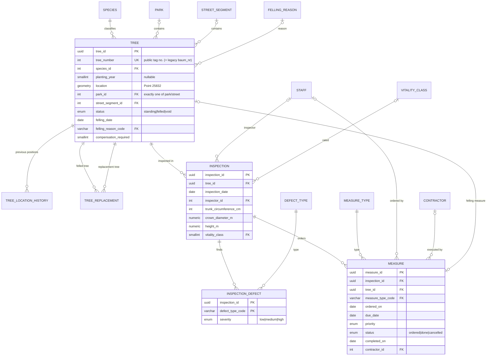

# Urban Tree Cadastre – Data Model (draft v0.1.0)

First draft of the data model for the new tree cadastre. It is based on
`requirements.md` (v0.3) and the legacy schema dump `legacy_trees.sql` (2026-09-30).

- **Application database:** PostgreSQL ≥ 15 with PostGIS ≥ 3.3, using ETRS89 / UTM 32N (EPSG:25832)
- **Monthly agency exchange:** JSON, validated by JSON Schema draft 2020-12
- **Nightly open data:** materialized view `mv_open_data_tree`, with no personal data

All assumptions are in **[ASSUMPTIONS.md](ASSUMPTIONS.md)**. Please read the
"Items to check first" table there before anything else.

## Contents

| File | Purpose |
|------|---------|
| `ASSUMPTIONS.md` | Numbered assumptions (A-01 to A-31) and open questions |
| `sql/01_schema.sql` | Extensions, enums, code lists, master data, core tables, constraints, indexes |
| `sql/02_audit_and_rules.sql` | Bookkeeping triggers, optimistic locking, audit log, no-delete rules, location history, roles and grants |
| `sql/03_views.sql` | Current-state view, overdue inspections, open compensation, open-data materialized view, `export_agency_exchange()` |
| `sql/04_seed_codelists.sql` | Placeholder code lists (vitality, defects, measure types, felling reasons) |
| `sql/90_migrate_legacy.sql` | One-off migration `baum` / `kontrolle` / `massnahme` → new model, with mapping tables and an issue log |
| `json-schema/tree-exchange.schema.json` | JSON Schema for the monthly exchange file to the regional agency |
| `json-schema/examples/exchange-2026-10.example.json` | Valid example file (standing tree, felled tree with replacement, inspections, measures) |
| `tests/validate_exchange_schema.py` | Validates the example and checks that 11 broken variants are rejected |

Install order: `01` → `02` → `03` → `04` → (load species list, parks and streets) → `90`.

## Entity-relationship overview

There are two more tables that are not drawn here:
- `audit_log`, which records every change to the core tables and code lists
- `export_run`, which keeps a record of each export

## Requirements traceability

| Requirement | Where it is covered |
|-------------|---------------------|
| UC1 Register a tree | `tree` (point geometry in 25832, FK to `species`, optional `planting_year`, exactly one of `park_id` / `street_segment_id`). A trigger blocks inactive species for new trees. |
| UC1 Species list of about 900 entries, extended by arborists | `species` table (not an enum), with `is_active` and `replaced_by_id` for renames |
| UC2 Inspection with measurements, vitality and any number of defects | `inspection`, `inspection_defect`, `defect_type`, `vitality_class` |
| UC2 Never deleted, auditable | `trg_forbid_delete` (also covers the table owner and TRUNCATE), no DELETE grant, `audit_log` with old and new JSONB and the user from `app.user` |
| UC3 Order a measure, then mark it done | `measure`, ordered from an inspection (composite FK). CHECK: `done` requires `completed_on` and a contractor. |
| UC4 Felling without deleting, compensation planting | `tree.status = 'felled'` with date and reason; `tree_replacement` (M:N); `v_compensation_open` |
| UC5 Nightly open data | `mv_open_data_tree`: standing trees, public id, species, planting year, coordinates (25832 and WGS84), latest vitality. No personal data. |
| UC5 Monthly agency file | `export_agency_exchange(start, end, municipality, organisation)` → JSON that follows `tree-exchange.schema.json` |
| Map view: about 5,000 trees in under 1 s | GiST index on `tree.location`, `(tree_id, inspection_date DESC)` index for the latest inspection, `v_tree_current` |
| Offline tablets | Client-generated UUID keys, `row_version` optimistic locking, `updated_at` indexes for "changed since" sync, `inspection.recorded_at` |
| Inspector names are personal data | Isolated in `staff.full_name` (marked in comments). Open data has no person reference. The agency file has only the pseudonymous `staff_code`. |
| Location corrections with history | A trigger writes the old point, its validity period, the user and the reason to `tree_location_history`. `tree.location_corrected_at` records the last correction. |
| Volumes: 180k trees, about 6M inspections over 30 years | Plain tables with no partitioning needed. Indexes are listed in `01_schema.sql`. |

## Legacy → new model mapping

| Legacy | New | Notes |
|--------|-----|-------|
| `baum.baum_nr` | `tree.tree_number` | Kept as the public number. The new UUID `tree_id` is generated. |
| `baum.art_lat` (free text) | `tree.species_id` via `legacy.map_species` | Matched on a normalised name and reviewed manually. Unmatched names get the inactive placeholder `XX_UNKNOWN`. The original text is kept in `tree.legacy_species_text`. |
| `baum.pflanzjahr` | `tree.planting_year` | Implausible values become NULL and are logged. |
| `baum.x`, `baum.y` | `tree.location` | Assumed to be EPSG:25832 (A-02). Rows without coordinates are **not** migrated and are logged. |
| `baum.strasse`, `baum.park` | `tree.street_segment_id` / `park_id` | Matched by name. Placeholders are created where needed. A spatial re-assignment is recommended later. |
| `baum.gefaellt = 'J'` | `tree.status = 'felled'` | The date comes from the latest felling measure if there is one. The reason is `UNKNOWN_LEGACY`. |
| `baum.angelegt_am / geaendert_*` | `created_at`, `updated_*` and one baseline `audit_log` row | |
| `kontrolle.*` | `inspection` | Crown diameter is not recorded in legacy. `kontrolleur` → `staff` (codes `LEG-nnnn`). |
| `kontrolle.maengel` (comma list) | `inspection_defect` via `legacy.map_defect` | Severity is NULL for legacy rows. Unmapped tokens become `OTHER`. The raw text is kept. |
| `massnahme.art` | `measure.measure_type_code` via `legacy.map_measure_type` | |
| `massnahme.faellig / erledigt / firma` | `due_date` / `completed_on` + `status` / `contractor_id` | `ordered_on` is the inspection date. Priority is `normal`. |

Problems found during migration are written to `legacy.migration_issue`. The script ends
with a reconciliation query comparing legacy and migrated row counts.

## Design notes

- **Code lists:** the department maintains species, defects, measure types, felling reasons and vitality classes, so these are lookup tables. Value sets that only change with the software (status, severity, priority, origin) are PostgreSQL enums.
- **No hard deletes on business data.** Trees use `felled`/`void`, measures use `cancelled`, and inspections are permanent. Only defect lines and replacement links can be deleted, and those deletions are audited.
- **Audit:** a single generic trigger writes `audit_log` with only the columns that actually changed. The application must run `SET LOCAL app.user = ...` in each transaction (A-19). Only `cadastre_auditor` can read the audit log.
- **Roles:**
  - `cadastre_app`: read and write, with no DELETE on protected tables
  - `cadastre_auditor`: read everything
  - `cadastre_export`: export job
  - `open_data_reader`: the open data materialized view only
- **Exchange file design:**
  - `additionalProperties: false` everywhere, so no undeclared field (for example an inspector name) can leak into the file.
  - Nullable fields are always present and explicitly null.
  - Conditional rules cover `felling` and `completedOn`.
  - The schema has its own version (`schemaVersion`, currently `0.1.0`). Breaking changes require a new major version, agreed with the agency.

## Verification status

- **JSON Schema:** checked against the draft 2020-12 metaschema. The example file validates, and all 11 negative tests are rejected (`python datamodel/tests/validate_exchange_schema.py`).
  - Note: `date-time` format checking only works if `rfc3339-validator` is installed. `date` is checked.
- **SQL:** all five scripts, including the PL/pgSQL function bodies, parse with the PostgreSQL parser (libpg_query/pglast, PG 17 grammar).
  - **They have not been run against a live PostgreSQL/PostGIS database**, because none was available.
  - Next steps:
    - Install the scripts on a dev instance.
    - Run the migration against the 2026-09-30 dump.
    - Validate the output of `export_agency_exchange()` against the schema.
    - Time the bounding-box query with real data.
