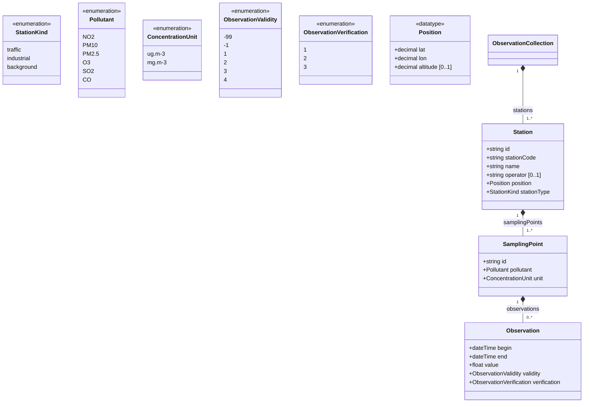

# Air Quality Observations 0.1.0

Hourly air quality measurements delivered by partner organisations: monitoring stations, their sampling points (one pollutant each) and the time series of observations.

## Overview

| | |
|---|---|
| Version | 0.1.0 |
| Status | draft |
| Purposes | exchange, api |
| Languages | en |
| Namespace | http://example.org/airquality/2.1 |

## Review status

**Not yet confirmed (proposed):** elements still 'proposed': ['Pollutant', 'ConcentrationUnit', 'ObservationValidity', 'ObservationVerification']

**Missing translations:** none

**Open questions and assumptions:**

- **Q-001 (blocking for persistence and API URLs)** Are `station/@id` and `sampling/@id` stable across deliveries, or generated per document? xs:ID is only unique within one document and cannot start with a digit (so no UUIDs or purely numeric codes). Proposal: Station keyed by `stationCode`; SamplingPoint keyed by `@id` only if stable, otherwise by (stationCode, pollutant).
- **Q-002** Pollutant: notation (`NO2`) or EEA numeric id (`8`) / URI? S1 says "code from the EEA pollutant vocabulary, e.g. NO2", but in that vocabulary the identifier is numeric and `NO2` is the notation. Do partners spell PM2.5 consistently? Proposal: notation, checked against the known list with warnings.
- **Q-003** Unit: which strings do partners send (`ug.m-3`, `µg/m3`, `ug/m3` ...)? Proposal: adopt the EEA `uom/concentration` notations and map variants on ingest. Values not verified.
- **Q-004** Altitude: is there a difference between an omitted `altitude` and `xsi:nil`? Proposal: treat both as "unknown"; the API returns `null`.
- **Q-005** Time: do `begin`/`end` always carry a UTC offset? Is the interval `[begin, end)`? Hourly means only, or other averaging periods too (the schema allows any interval)?
- **Q-006** Station classification: adopt EEA `aq/stationclassification` URIs? The area type (urban/suburban/rural), which EEA reporting uses alongside traffic/industrial/background, is missing in S1.
- **Q-007** Re-deliveries: do partners resend observations with an updated `verification` or `value`? Proposal: upsert by (samplingPoint, begin) and keep an audit trail (history: audit).
- **Q-008** Delivery granularity: how often and how much per document (hourly push, daily file, full history)? Station master data is repeated in every delivery; which copy wins when they differ?
- **Q-009** Versioning: should the first model release be numbered 2.1.0 to mirror the partner XSD? Should the namespace stay version-bearing (`.../2.1`)? A version in the namespace makes every future version a namespace change for partners.
- **Q-010** Strings have no length or pattern limits in S1 (stationCode, name, operator, ids). Any known limits? Adding them would narrow the wire format.
- **Q-011** Should `operator` be an organisation code/URI rather than free text?
- A-001 Partners validate strictly against XSD 2.1, so `compatibility.consumers: strict`. (confirmed: no)
- A-002 `stationCode` is unique and stable across deliveries (persistent station identifier). (confirmed: no)
- A-003 The six pollutants are NO2, PM10, PM2.5, O3, SO2, CO. (confirmed: no)
- A-004 `validity` and `verification` use the EEA AQD observation validity / verification codes. (confirmed: no)
- A-005 Coordinates are WGS 84 (EPSG:4326) decimal degrees; altitude in metres above mean sea level. (confirmed: no)
- A-006 The observation interval is `[begin, end)`, normally one hour. (confirmed: no)

## Diagram

## Object types

### ObservationCollection

One delivery from a partner: a set of stations with their sampling points and observations. Root element of the exchange document.

- History: none
- Volume: one per partner delivery (frequency unknown, Q-008)
- Source: S1

| Attribute | Label | Type | Mult. | Definition | Notes |
|---|---|---|---|---|---|

**Associations**

| Role | Target | Mult. | Kind | Definition |
|---|---|---|---|---|
| `stations` | Station | 1..* | composition | Stations contained in a delivery. |

### Station

Air quality monitoring station at a fixed location.

- Identifier: `stationCode` (natural)
- History: audit
- Volume: 400 (+stable)
- Source: S1

| Attribute | Label | Type | Mult. | Definition | Notes |
|---|---|---|---|---|---|
| `id` |  | string | 1 | Document-local identifier (xs:ID) of the station element. Only unique within one delivery and must not start with a digit; not to be used as a persistent key (Q-001). |  |
| `stationCode` |  | string | 1 | Code of the station, assumed stable across deliveries and used as the persistent identifier (A-002). Possibly the EEA/national station code (e.g. "DEBE010") — to confirm. | unique |
| `name` |  | string | 1 | Name of the station. |  |
| `operator` |  | string | 0..1 | Organisation operating the station (free text in S1). |  |
| `position` |  | Position | 1 | Location of the station. |  |
| `stationType` |  | StationKind | 1 | Station classification by dominant emission source. |  |

**Associations**

| Role | Target | Mult. | Kind | Definition |
|---|---|---|---|---|
| `samplingPoints` | SamplingPoint | 1..* | composition | Sampling points operated at a station. |

### SamplingPoint

Measurement configuration at a station for one pollutant, delivering one time series of observations in one unit.

- Identifier: `id` (natural)
- History: audit
- Volume: 2400 (+stable)
- Source: S1

| Attribute | Label | Type | Mult. | Definition | Notes |
|---|---|---|---|---|---|
| `id` |  | string | 1 | Identifier (xs:ID) of the sampling point. S1 only makes it unique within one document; whether it is stable across deliveries is unknown (Q-001). Used as identifier provisionally. |  |
| `pollutant` |  | Pollutant | 1 | Pollutant measured, as the notation code of the EEA pollutant vocabulary (e.g. NO2). |  |
| `unit` |  | ConcentrationUnit | 1 | Unit of all observation values of this sampling point. |  |

**Associations**

| Role | Target | Mult. | Kind | Definition |
|---|---|---|---|---|
| `observations` | Observation | 0..* | composition | Time series of observations of a sampling point. |

### Observation

One aggregated measurement result of a sampling point for a time interval (normally one hour).

- History: audit
- Volume: 21000000/year (+~57,600 per day (400 stations × 6 pollutants × 24 hours), ~21 M per year)
- Source: S1

| Attribute | Label | Type | Mult. | Definition | Notes |
|---|---|---|---|---|---|
| `begin` |  | dateTime | 1 | Start of the averaging interval (inclusive). Must carry a UTC offset (C-003). |  |
| `end` |  | dateTime | 1 | End of the averaging interval (exclusive assumed, A-006). |  |
| `value` |  | float | 1 | Measured value in the unit of the sampling point. xsi:nil when no value is available; the reason should then be expressed by the validity flag (C-004). | voidable |
| `validity` |  | ObservationValidity | 1 | Validity flag (EEA AQD observation validity code). |  |
| `verification` |  | ObservationVerification | 1 | Verification status (EEA AQD observation verification code). |  |

## Value types

### Position

Geographic position of a station. CRS is not stated in S1; WGS 84 (EPSG:4326) decimal degrees assumed (A-005). Kept as lat/lon/altitude rather than a geometry for wire compatibility (D-002).

- Source: S1

| Attribute | Label | Type | Mult. | Definition | Notes |
|---|---|---|---|---|---|
| `lat` |  | decimal | 1 | Latitude in decimal degrees (assumed WGS 84). | min=-90, max=90 |
| `lon` |  | decimal | 1 | Longitude in decimal degrees (assumed WGS 84). | min=-180, max=180 |
| `altitude` |  | decimal | 0..1 | Altitude of the station. Unit and vertical datum not stated in S1; metres above mean sea level assumed (A-005). S1 allows both omission and xsi:nil — meaning of the difference unclear (Q-004). | unit=m, voidable |

## Code lists

### StationKind

Classification of a station by the dominant emission sources influencing it.

- Source: S1

*closed*

| Code | Label | Definition |
|---|---|---|
| `traffic` | Traffic | Station whose pollution level is determined predominantly by emissions from nearby traffic. |
| `industrial` | Industrial | Station whose pollution level is determined predominantly by nearby industrial sources. |
| `background` | Background | Station whose pollution level is not dominated by a single source or street. |

### Pollutant

Air pollutant measured at a sampling point. S1 says the value is a "code from the EEA pollutant vocabulary, e.g. NO2, PM10, O3", i.e. the vocabulary's notation, not its numeric identifier (Q-002).

- Source: S1, S2
- *proposed*

*extensible* — Values from AQD - Air Quality Pollutants <http://dd.eionet.europa.eu/vocabulary/aq/pollutant> retrieved 2026-11-23 (subset).

| Code | Label | Definition | URI |
|---|---|---|---|
| `NO2` | Nitrogen dioxide (air) |  | http://dd.eionet.europa.eu/vocabulary/aq/pollutant/8 |
| `PM10` | Particulate matter < 10 µm (aerosol) |  | http://dd.eionet.europa.eu/vocabulary/aq/pollutant/5 |
| `PM2.5` | Particulate matter < 2.5 µm (aerosol) |  | http://dd.eionet.europa.eu/vocabulary/aq/pollutant/6001 |
| `O3` | Ozone (air) |  | http://dd.eionet.europa.eu/vocabulary/aq/pollutant/7 |
| `SO2` | Sulphur dioxide (air) |  | http://dd.eionet.europa.eu/vocabulary/aq/pollutant/1 |
| `CO` | Carbon monoxide (air) |  | http://dd.eionet.europa.eu/vocabulary/aq/pollutant/10 |

### ConcentrationUnit

Unit of measure of the observed values at a sampling point.

- Source: S1
- *proposed*

*extensible*

| Code | Label | Definition |
|---|---|---|
| `ug.m-3` | microgram per cubic metre |  |
| `mg.m-3` | milligram per cubic metre |  |

### ObservationValidity

Validity flag of an observation (EEA AQD observation validity).

- Source: S1, S2
- *proposed*

*extensible* — Values from AQD - Observation Validity <http://dd.eionet.europa.eu/vocabulary/aq/observationvalidity> retrieved 2026-11-23.

| Code | Label | Definition | URI |
|---|---|---|---|
| `-99` | Not valid due to station maintenance or calibration |  | http://dd.eionet.europa.eu/vocabulary/aq/observationvalidity/-99 |
| `-1` | Not valid |  | http://dd.eionet.europa.eu/vocabulary/aq/observationvalidity/-1 |
| `1` | Valid |  | http://dd.eionet.europa.eu/vocabulary/aq/observationvalidity/1 |
| `2` | Valid, but below detection limit |  | http://dd.eionet.europa.eu/vocabulary/aq/observationvalidity/2 |
| `3` | Valid, but below detection limit and number replaced by 0.5*detection limit |  | http://dd.eionet.europa.eu/vocabulary/aq/observationvalidity/3 |
| `4` | Valid (Ozone only) using CCQM.O3.2019 |  | http://dd.eionet.europa.eu/vocabulary/aq/observationvalidity/4 |

### ObservationVerification

Verification status of an observation (EEA AQD observation verification).

- Source: S1, S2
- *proposed*

*extensible* — Values from AQD - Observation Verification <http://dd.eionet.europa.eu/vocabulary/aq/observationverification> retrieved 2026-11-23.

| Code | Label | Definition | URI |
|---|---|---|---|
| `1` | Verified |  | http://dd.eionet.europa.eu/vocabulary/aq/observationverification/1 |
| `2` | Preliminary verified |  | http://dd.eionet.europa.eu/vocabulary/aq/observationverification/2 |
| `3` | Not verified |  | http://dd.eionet.europa.eu/vocabulary/aq/observationverification/3 |

## Rules

| ID | Applies to | Rule | Enforcement |
|---|---|---|---|
| C-001 | Observation | The end of the interval must be after its begin. | enforced, all |
| C-002 | SamplingPoint | Within one sampling point, at most one observation per interval begin (no duplicates or overlapping intervals in one delivery). | warning, all |
| C-003 | Observation | begin and end must carry an explicit UTC offset (e.g. 2026-11-23T10:00:00+01:00). S1's xs:dateTime also accepts local times without offset; such values are ambiguous. | warning, all |
| C-004 | Observation | If value is nil, validity must be a "not valid" code (-1 or -99); if validity is 1–4, value must not be nil. | warning, all |
| C-005 | Observation | Interval length is one hour for hourly data (end - begin = PT1H). | documented, all |

---
*Generated by dmtool docs from AirQualityObservations 0.1.0 (en).*
