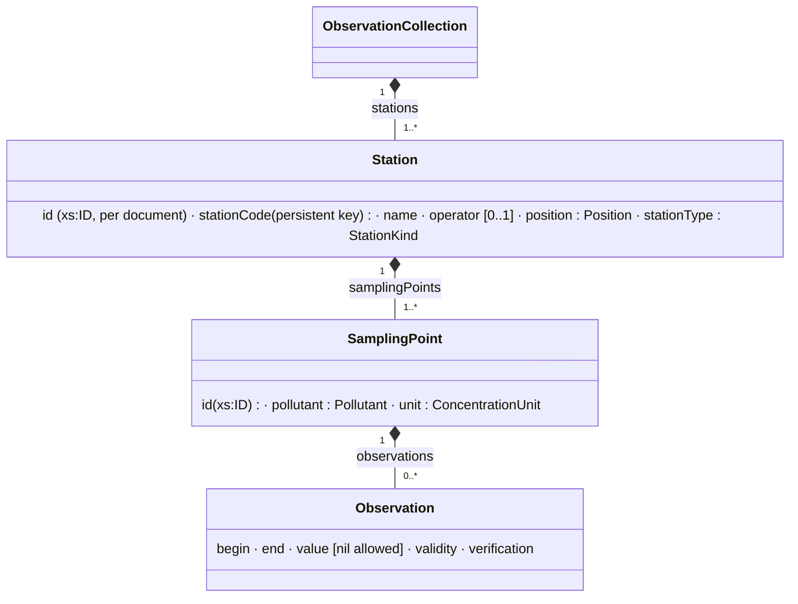

# Air quality XSD 2.1: data model and JSON Schema

I turned `observations.xsd` (v2.1) into a canonical model in `datamodel/model.yaml`. Both schemas are now generated from that one file:

- **JSON Schema** for the API: `datamodel/exports/draft/schema.json`
- **XSD** for partner exchange: `datamodel/exports/draft/schema.xsd`

I tested the generated XSD against the original with lxml, using a sample delivery and 10 variants (some valid, some deliberately broken). Both schemas gave the same verdict every time, with one intended exception, listed under "What I decided". So partners can keep sending exactly what they send today. The sample files are in `examples/` (the XML and the same data as JSON).

The draft is not released (version 0.1.0). Some elements are still marked "proposed" and wait for your review.

## The model

| Element | Kind | Notes |
|---|---|---|
| Station | object type | Key: `stationCode`, assumed stable across deliveries. The XML `@id` is only valid within one document. |
| SamplingPoint | object type, part of a Station | One pollutant and one unit per time series. |
| Observation | object type, part of a SamplingPoint | Natural key (samplingPoint, begin). Changes are kept as an audit trail because re-deliveries with new verification flags are likely. |
| Position | value type | lat/lon/altitude, kept as in the XSD rather than turned into a geometry. |
| StationKind | closed code list | traffic, industrial, background |
| Pollutant | open code list | Linked to the EEA AQD pollutant vocabulary, which the XSD itself names. |
| ObservationValidity / ObservationVerification | open integer code lists | Assumed to be the EEA AQD flags (-99, -1, 1–4 and 1–3). |
| ConcentrationUnit | open code list | ug.m-3 and mg.m-3 so far. |

Volume: 400 stations × 6 pollutants × 24 hours = 57,600 observations a day, about 21 M a year. That doesn't change the logical model, but the API should:
- page time series, with a query by sampling point (or station + pollutant) and time range;
- store observations partitioned by time;
- upsert on (samplingPoint, begin).

A JSON delivery uses the same shape as the XML. The only difference is plural array names (`stations`, `samplingPoints`, `observations`); the XSD keeps `station`, `sampling` and `observation`. The same `$defs` (Station, SamplingPoint, Observation) can be used directly as REST resource bodies.

## Ambiguous or questionable points in the XSD

1. **Two identifiers, neither clearly persistent.** `@id` is `xs:ID`: it is unique only within one document and can't start with a digit, so it can't hold UUIDs or numeric codes. `stationCode` has no uniqueness rule. For `sampling/@id` it's unclear whether it stays the same between deliveries. This blocks stable API URLs (Q-001).
2. **Pollutant "code" is ambiguous.** The documentation says "code from the EEA pollutant vocabulary, e.g. NO2". In that vocabulary the code is numeric (NO2 = 8, PM2.5 = 6001), and "NO2" is only the notation. The element is a free `xs:string`, so any spelling gets through (Q-002).
3. **`unit` is a free string** with no code list, which invites `µg/m3`, `ug/m3` and `ug.m-3` side by side (Q-003).
4. **`validity` and `verification` are bare `xs:int`** with no named code list. They look like the EEA AQD flags, but the XSD doesn't say so (A-004).
5. **Time zones are not required.** `xs:dateTime` accepts `2026-11-22T00:00:00` with no offset, which is ambiguous across DST. Nothing in the XSD stops `end` ≤ `begin`, non-hourly intervals, or duplicate or overlapping observations (C-001 to C-005, Q-005).
6. **Two ways to say "no value":** `altitude` can be left out *and* can be `xsi:nil`. `value` is nillable while `validity` is still mandatory, so a nil value with validity 1 is possible (C-004, Q-004).
7. **Position has no coordinate reference system.** Lat/lon have no stated CRS (I assumed WGS 84) and no range check. Altitude has no unit or datum (A-005).
8. **Station data is mixed with measurements.** The full station record is repeated in every delivery, and the XSD doesn't say which copy wins when two disagree (Q-008).
9. **The version is in the namespace (`.../2.1`).** Every future version becomes a namespace change for partners (Q-009).
10. **Smaller points:**
    - the root element carries no delivery metadata (sender, creation time, period);
    - strings have no length limits (Q-010);
    - `operator` is free text rather than a reference (Q-011);
    - there is no area type (urban/suburban/rural), although EEA reporting uses one alongside the station type (Q-006).

## What I decided, so you can review it

- **XSD 2.1 compatibility** (D-001): I kept the namespace, the `@id` attributes, the element names and the type names. The one intended tightening is a latitude/longitude range check (D-002): a document with lat = 95 passed 2.1 but fails the generated XSD. Remove the check if you want byte-for-byte equal acceptance.
- **Open code lists** (D-003): Pollutant, Unit, Validity and Verification are open lists, so the XSD stays `xs:string`/`xs:int` and today's documents still pass. The JSON Schema lists the known values with their EEA URIs.
- **Assumed pollutants:** NO2, PM10, PM2.5, O3, SO2, CO (A-003).
- **Unverified EEA details:** I couldn't open the Eionet register directly from here, only through web search. I confirmed NO2 = 8, PM2.5 = 6001 and the validity and verification codes. The URIs for PM10, O3, SO2 and CO and some validity labels come from my own knowledge and are marked as unverified in the model.
- **Date-time checking in JSON:** the JSON Schema uses `format: date-time`, which in principle requires an offset. Most validators only check formats when you turn that on, and my test run didn't reject a local time. Enable format checking in your API validator.

## Files

- `datamodel/model.yaml`: the canonical model
- `datamodel/review.md`: readable data dictionary for review
- `datamodel/open-questions.md`: questions Q-001 to Q-011 and assumptions A-001 to A-006
- `datamodel/decisions.md`, `datamodel/sources.md`, `datamodel/glossary.md`, `datamodel/CHANGELOG.md`
- `datamodel/exports/draft/`: `schema.json`, `schema.xsd`, `diagram.mmd`
- `examples/`: `sample-delivery.xml` and `sample-delivery.json`

## Questions for your review

The most important ones:
1. Is `stationCode` the stable station key, and is `sampling/@id` stable between deliveries? (Q-001)
2. Should pollutants be sent as the notation (`NO2`) or the EEA numeric code or URI? (Q-002)
3. Do partners resend corrected or re-verified values? (Q-007)
4. Should the first release be numbered 2.1.0 to match the partner XSD? (Q-009)

Once these are settled I'll mark the proposed elements as confirmed and run the release. That snapshots the model and regenerates both schemas.

Sources: [EEA AQD pollutant vocabulary](https://dd.eionet.europa.eu/vocabulary/aq/pollutant/view), [EEA observation validity](https://dd.eionet.europa.eu/vocabulary/aq/observationvalidity), [EEA observation verification](https://dd.eionet.europa.eu/vocabulary/aq/observationverification)
